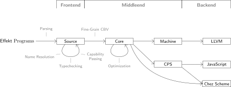

# The Effekt Compiler

This page gives a brief overview of the Effekt compiler and points you to the research behind it.

> **Reading one of our papers?**
> Effekt has changed since many of our papers were published.
> Please see [Language Evolution](/evolution) for the differences to each paper.
> All of our papers, including those on compiling Effekt, are listed on the [Research Papers](/publications) page.

## Compiler Pipeline

The compiler pipeline for Effekt, at the time of writing, can be illustrated as follows:

<figure>

</figure>

The compilation is divided into the following large phases: parsing, frontend, middleend and backend.
As you can see, Effekt supports multiple backends.
While the steps in the frontend phase are shared for all backends, some of the middleend steps are specific to some backends.

The source code modeling the pipeline can be found in [Compiler.scala](https://github.com/effekt-lang/effekt/blob/main/effekt/shared/src/main/scala/effekt/Compiler.scala).

In the following, we briefly describe the different phases.

### Parsing

The first step is to parse the given Effekt program into an AST called [Source](https://github.com/effekt-lang/effekt/blob/main/effekt/shared/src/main/scala/effekt/source/Tree.scala).

### Frontend

On Source there are several steps carried out, mainly:

- [Name Resolution](https://github.com/effekt-lang/effekt/blob/main/effekt/shared/src/main/scala/effekt/Namer.scala)
- [Typechecking](https://github.com/effekt-lang/effekt/blob/main/effekt/shared/src/main/scala/effekt/Typer.scala)
- [Translation to Capability-Passing Style](https://github.com/effekt-lang/effekt/blob/main/effekt/shared/src/main/scala/effekt/source/ExplicitCapabilities.scala)

The ideas behind effects as capabilities are described in our papers on [language design](/publications#language-design).

### Middleend

Subsequently, the Source IR is translated step-by-step to different IRs:

- The first translation is to an IR in fine-grain call-by-value, called Core, which corresponds to `System Xi` in [this paper](https://se.cs.uni-tuebingen.de/publications/brachthaeuser20effects/) and `System C` in [this paper](https://se.cs.uni-tuebingen.de/publications/brachthaeuser22effects/).
  Note that Core has changed since these papers, see [Language Evolution](/evolution) for details.
- Then we do many optimization passes on [Core](https://github.com/effekt-lang/effekt/blob/main/effekt/shared/src/main/scala/effekt/core/Tree.scala) itself, for example monomorphization (see _The Simple Essence of Monomorphization_ in [General Compilation Techniques](/publications#general-compilation-techniques)).
- For the JavaScript backends and the `chez-cps` backend, we translate Core to an IR in continuation-passing style, called [CPS](https://github.com/effekt-lang/effekt/blob/main/effekt/shared/src/main/scala/effekt/cps/Tree.scala).
- For the LLVM backend, we translate Core to a more low-level IR called [Machine](https://github.com/effekt-lang/effekt/blob/main/effekt/shared/src/main/scala/effekt/machine/Tree.scala), described in _Multiple Resumptions and Local Mutable State, Directly_ (see [Compilation of Effect Handlers](/publications#compilation-of-effect-handlers)).

### Backend

The final step is the translation to the corresponding backend language.
The different backends are targeted from different IRs:

- From Core there are translations to Chez Scheme (the backends `chez-callcc` and `chez-monadic`).
- From CPS there are translations to JavaScript (the backends `js` and `js-web`) and to Chez Scheme (the backend `chez-cps`).
- From Machine there is a translation to LLVM (the backend `llvm`).

## Further Reading

- [Language Evolution](/evolution) summarizes how Effekt has changed since each of our papers.
- [Research Papers](/publications) lists our papers, including those on [compiling effect handlers](/publications#compilation-of-effect-handlers) and on [general compilation techniques](/publications#general-compilation-techniques).
- [Lift Inference](/docs/implementation/lift-inference) describes the implementation strategy that Effekt used before version 0.4.0.
- [Contributing](/contributing) explains how to build the compiler and how to work on it.
